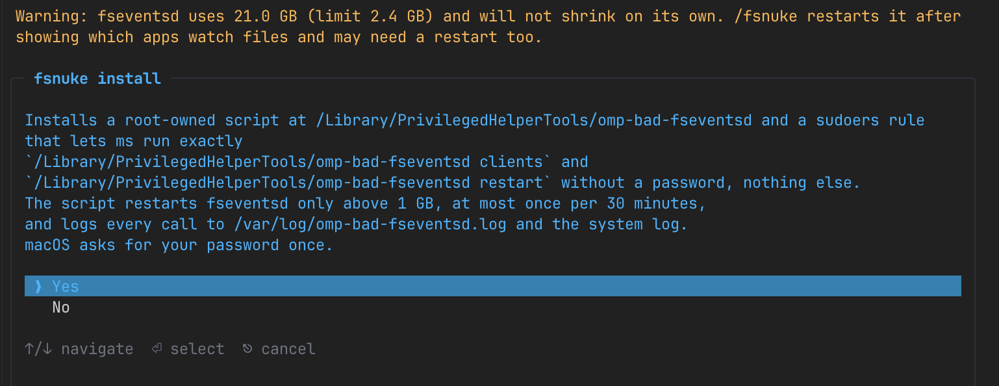
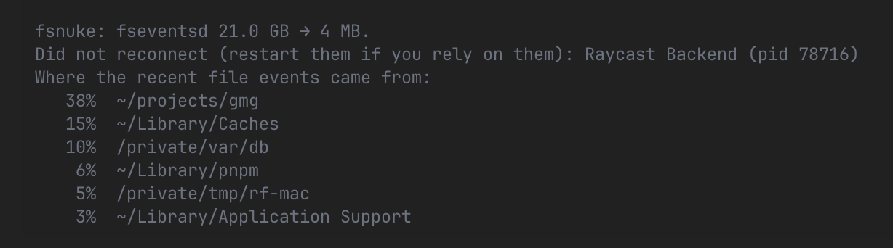

# omp-bad-fseventsd [](https://github.com/MrTin/omp-bad-fseventsd/actions/workflows/ci.yml)

When macOS `fseventsd` runs away, you hear about it. It is restarted only when you say so.

An [omp](https://github.com/can1357/oh-my-pi) extension for macOS. `fseventsd` is the daemon that tells apps which files changed. When it sees enough new, unique file paths in a short time, it can switch into a state where it keeps every one of them and never frees them: GBs of memory, one core pinned, swap filling up. It does not recover until it is restarted. Agents that create and delete thousands of files trigger it: git worktrees with `node_modules`, package installs, test suites that build fixture trees in `$TMPDIR`.



## Install

```bash
omp plugin install github:MrTin/omp-bad-fseventsd
```

Restart omp. To be able to restart the daemon, install the root helper once:

```text
/fsnuke install     # macOS asks for your password once
```

## Use

```text
/fsnuke             # show what holds an event stream, ask, restart, report
/fsnuke status      # current size, limit, helper state, last helper calls
/fsnuke uninstall   # remove the helper and its sudoers rule
```

`/fsnuke` first lists the apps that hold an event stream, and which of them an omp session started. Nothing happens until you confirm. Afterwards it reports:



A session whose own processes did not reconnect gets a note for its agent on the next turn, naming them, so it restarts its dev server or watcher.

## What a restart does

| | Effect |
|---|---|
| File operations (git, cp, installs, builds) | None. They never go through fseventsd; agents can keep working |
| Spotlight | None. It reads file events from the kernel directly |
| fseventsd's event history | Erased. Time Machine does one full scan on its next backup; sync apps may rescan |
| Apps holding an event stream | Some reconnect (Finder, cfprefsd). Others stop seeing file changes until restarted: dev servers, watch-mode builds and tests, some editors. `/fsnuke` lists them before and after |

## Tweak

```bash
omp plugin config set omp-bad-fseventsd limitGB 4     # warn above 4 GB
omp plugin config delete omp-bad-fseventsd limitGB    # back to auto
```

| Setting | Default | Env | Meaning |
|---|---|---|---|
| `limitGB` | `0` | `OMP_BAD_FSEVENTSD_LIMIT_GB` | Warn above this. `0` = 5% of RAM, at least 2 GB |

Apple's own budget for `fseventsd` is 30 MB (`launchctl print system/com.apple.fseventsd | grep jetsam`). It has been seen to grow to a few hundred MB and shrink back by itself, so the helper refuses to restart below 1 GB whatever the setting.

## Security

Restarting needs root: `fseventsd` runs as root and System Integrity Protection blocks `launchctl kickstart` for it even for root. `/fsnuke install` uses macOS's own password dialog to install:

- `/Library/PrivilegedHelperTools/omp-bad-fseventsd`: a root-owned shell script (`helper/omp-bad-fseventsd.sh`), passed to the root shell as an argument, not copied from a file you can write to.
- `/etc/sudoers.d/omp-bad-fseventsd`: lets your user run exactly `… clients` and `… restart` without a password. Nothing else, no other arguments, no other users. It is checked with `visudo -c` before it goes live.

The limits live in the root-owned script, so nothing running as you (an agent included) can loosen them:

- acts only on Apple's `fseventsd` binary, matched by its full path, re-checked before `SIGKILL`
- restarts only above 1 GB, at most once per 30 minutes (a failed attempt counts)
- fixed `PATH`, no input besides the one-word command
- every call, refusals included, goes to `/var/log/omp-bad-fseventsd.log` (root-owned) and the system log (`log show --last 1d --predicate 'eventMessage BEGINSWITH "omp-bad-fseventsd:"'`)

An agent can run `sudo -n /Library/PrivilegedHelperTools/omp-bad-fseventsd restart` itself; the limits above still apply, and it shows up in the log. The extension gives the model no tool for it: restarting is your call.

## How it decides

- One omp process measures `fseventsd` every 10 minutes with `top` (its MEM column counts compressed memory; `ps` RSS does not, and a 21 GB daemon can show 11 GB RSS). No root.
- Every interactive session warns when the reading is over the limit, again when it doubles, or after 6 hours.
- `/fsnuke` asks the helper which processes hold an event stream (fseventsd names one thread per client; `sample` reads them as root), shows them, and restarts only after you confirm: `SIGTERM`, `SIGKILL` after 10 s if it is still running (runaway daemons have ignored `SIGTERM`), then waits for launchd to start it again.
- Before the restart, the helper copies the newest 2,000 history files (about 5 million events) for the "where from" report; the extension reads and deletes them.

## Differences from fseventsd-runaway

[talkstream/fseventsd-runaway](https://github.com/talkstream/fseventsd-runaway) documented the runaway well and is where the 30 MB budget and the `SIGTERM`-then-`SIGKILL` restart come from. Here:

- It checks every 10 minutes, not once at session start. omp sessions run for days, and the runaway grows within hours.
- It answers "where from" before the restart erases the evidence, instead of saving a listing and a `sample` for a bug report.
- It lists what depends on `fseventsd` before asking, and checks again after, instead of restarting blind.
- No unattended root LaunchDaemon. You confirm every restart.

## Prevent it

The real fix is fewer new, unique file paths: reuse a fixed pool of worktrees instead of adding and removing one per task, and share `node_modules` between them (pnpm: `virtualStoreType: global`, see [pnpm + git worktrees](https://pnpm.io/git-worktrees)).

## Files

| Where | What |
|---|---|
| `~/.omp/agent/bad-fseventsd/state.json` | last reading, last restart and who lost their stream |
| `~/.omp/agent/bad-fseventsd/leader.json` | which omp process measures |
| `/var/log/omp-bad-fseventsd.log` | every helper call (root-owned) |
| `/var/db/omp-bad-fseventsd/` | the helper's rate limit, and a history snapshot until the extension reads it |

## Limits

- macOS only; on other platforms the extension does nothing.
- The "where from" report is by directory, not by process: the event history does not record who made a change.
- Processes started outside omp's bash tool carry no omp session marker, so they are listed without one.

## Develop

```bash
bun install && bun test && bun run check
omp plugin link .
```

See [AGENTS.md](AGENTS.md) for layout, rules and releasing.

## License

MIT
